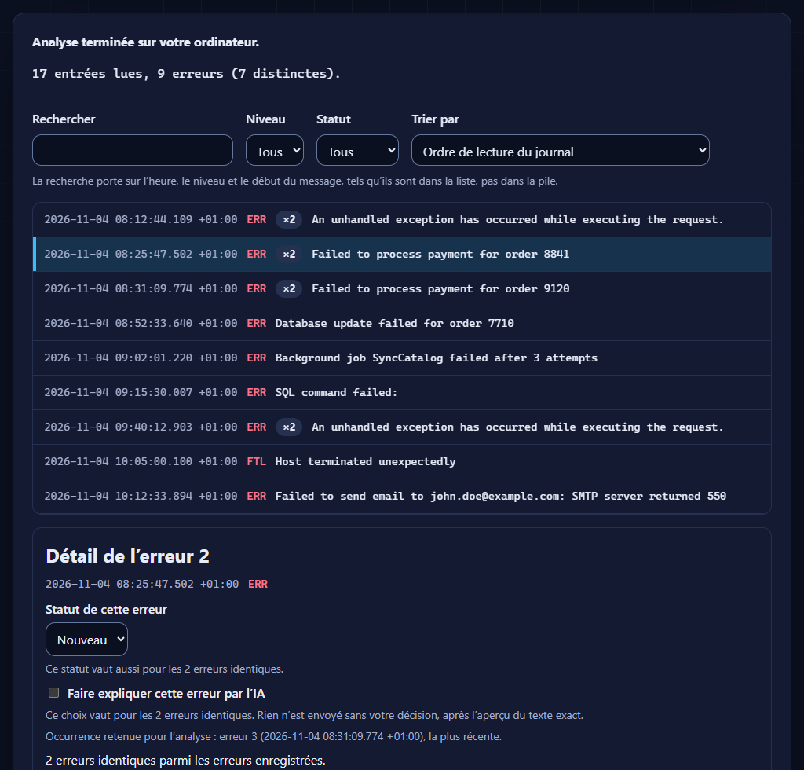

# Sherlog

Application web **100 % côté navigateur** qui lit des journaux (logs), isole **uniquement les erreurs** et regroupe celles qui sont identiques. Sur demande, elle les fait ensuite expliquer par un modèle d'IA, avec un chat par erreur.



> **État au 2026-11-19 :**
> - **En production** (https://mango-plant-0313ba703.4.azurestaticapps.net/, accès sur invitation) : étapes 0 à 10b de la feuille de route, et la lecture de l'export CSV du portail Log Analytics (étape 3b, première partie).
> - **Reste à faire** : la connexion directe à Azure Monitor (10c), les autres formats structurés de 3b (Serilog compact, JSON de l'API), l'historique local (11).
>
> Détail dans `docs/ROADMAP.md`.

## Le problème
Retrouver la cause d'une erreur dans des fichiers de logs de plusieurs centaines de Mo prend du temps. Envoyer ces fichiers à un service en ligne est souvent impossible, car ils contiennent des données sensibles. Sherlog fait le tri **dans le navigateur, sans serveur** : rien ne part, sauf les extraits que l'utilisateur choisit d'envoyer au fournisseur d'IA de son choix, après masquage et aperçu du texte exact.

## Le parcours
1. **Choisir une source** :
   - un fichier ou du texte collé ;
   - un dossier (navigateurs Chromium) ;
   - un lien vers un compte Azure Blob autorisé (lien SAS en lecture seule, 256 Mio au plus) ;
   - un export CSV du portail Log Analytics.
2. **Préparer** (facultatif) :
   - le format est reconnu, ou choisi s'il ne l'est pas ;
   - on peut écarter des entrées par un texte ou par une période ;
   - un aperçu et des compteurs sont calculés avant toute analyse.
3. **Analyser**, sur clic :
   - lecture en une passe dans un Web Worker, annulable ;
   - liste des erreurs, avec tri, filtres, recherche et statut par erreur (« Nouveau », « Analysé », « Ignoré », « Résolu ») ;
   - les erreurs identiques sont regroupées.
4. **Envoyer à l'IA**, sur une demande séparée :
   - Anthropic, avec la clé de l'utilisateur, ou Ollama en local ;
   - masquage des données sensibles, aperçu de ce qui part, analyse structurée, puis chat sur l'erreur.

## Choix techniques
- **Aucun backend.** Application monopage statique sur Azure Static Web Apps (plan gratuit). Le contrôle d'accès (connexion GitHub ou Microsoft, rôle `invited`) est appliqué par la configuration de la plateforme, jamais par le code client.
- **Lecture déterministe, sans IA** (`src/core`, TypeScript pur) :
  - les lignes sont découpées sur les octets, avant décodage : un caractère coupé entre deux blocs ne casse rien, et chaque entrée garde sa position exacte ;
  - seules les positions des erreurs restent en mémoire : leur texte est relu dans le fichier à la demande ;
  - les erreurs identiques sont regroupées par une empreinte, c'est-à-dire leur message débarrassé des valeurs qui changent (nombres, dates, GUID, adresses) ;
  - au-delà de 100 000 erreurs enregistrées, l'écran le dit.
- **Rien n'est deviné** :
  - un format non reconnu est signalé, et l'utilisateur choisit ;
  - les colonnes d'un export Azure sont relevées sur un export réel ;
  - une limite atteinte s'affiche, sans troncature silencieuse ;
  - une règle de masquage ne cache que ce qu'elle reconnaît sûrement.
- **Sécurité** :
  - **CSP stricte** : aucun script tiers, aucun style en ligne, `connect-src` limité à une liste figée de domaines ;
  - jamais de HTML brut ;
  - clé d'IA gardée dans `sessionStorage` ;
  - **masquage avant envoi**, par six règles, puis aperçu du texte exact qui sera envoyé ;
  - contre l'injection de prompt, le journal est traité comme une donnée entre des délimiteurs aléatoires, et la réponse du modèle n'est affichée comme une analyse que si elle suit un schéma JSON validé ; sinon, elle est montrée comme du texte brut, signalé comme tel ;
  - aucune télémétrie.
- **Qualité** :
  - TypeScript strict, ESLint sans aucun avertissement ;
  - **1 524 tests** Vitest écrits avant le code ;
  - **179 vérifications de bout en bout** dans un vrai Chrome, pilotées par le protocole DevTools, sans dépendance ajoutée : vrai worker sous la CSP de production, fichiers de 64 Mo, 100 000 erreurs, console sans erreur ;
  - les garde-fous sont aussi vérifiés par des tests de mutation : un outil local casse chaque règle, et un test doit échouer.
- **Livraison** :
  - GitHub Actions vérifie types, lint, tests, build et audit des dépendances livrées avant chaque déploiement ;
  - chaque pull request vers `main` a son environnement de prévisualisation ;
  - `dev` va vers `main` par pull request, et `main` correspond à la production.
- **Décisions écrites** : 24 ADR dans `docs/adr/`. Chacun donne le contexte, la décision et ses conséquences.

**Pile :** React 19, TypeScript 6 (strict), Vite 8, Vitest 5. Les seules dépendances livrées sont `react` et `react-dom`, avec des versions épinglées.

## Démarrage rapide (< 5 minutes)
Prérequis : Node 22.13 ou plus récent.
```bash
npm ci
npm run dev        # http://localhost:5173
```
Hors Azure Static Web Apps, `npm run dev` affiche « Identité indisponible » et une erreur 404 sur `/.auth/me` dans la console. C'est normal : cette route n'existe qu'une fois l'application déployée.

Pour essayer l'application construite, avec la CSP de production et une identité simulée :
```bash
npm run build
npm run serve:dist   # http://127.0.0.1:4173
```
Des journaux d'exemple, tous synthétiques sauf deux extraits réels, sont dans `samples/`. Leur contenu et les résultats attendus sont décrits dans `samples/README.md`.

## Développement
| Commande | Rôle |
|---|---|
| `npm run typecheck` | Vérification TypeScript strict |
| `npm run lint` | ESLint, zéro avertissement toléré |
| `npm test` | Tests Vitest |
| `npm run build` | Construit `dist/` |
| `npm run serve:dist` | Sert `dist/` avec les en-têtes de production (CSP) et une identité locale simulée. Ne reproduit pas le contrôle d'accès. Un autre port se donne avec `node scripts/serve-dist.mjs 4174` |
| `npm run e2e` | Parcours de bout en bout dans Chrome, après `npm run build`. Chrome ou Chromium requis (`CHROME_PATH` si introuvable) |
| `npm run audit` | `npm audit` au niveau high sur les dépendances **livrées** seulement : étape bloquante de la CI (ADR-024) |
| `npm run audit:all` | Le même audit, outils de développement compris : informatif, peut échouer sur un avis d'outillage sans correctif publié |

Pour essayer le contrôle d'accès en local, avec l'émulateur, qui peut différer du cloud : `npm run build`, puis `npx @azure/static-web-apps-cli@2.0.8 start ./dist`. La version est épinglée, et le paquet n'est pas une dépendance du projet.

Conventions :
- code, TSDoc et commentaires en anglais ; documentation et interface en français ;
- tests nommés `it('should … when …')` ;
- aucun style en ligne, car la CSP les bloque.

Documentation :
- `docs/SPEC.md` : la spécification ;
- `docs/ARCHITECTURE.md` : l'architecture ;
- `docs/ROADMAP.md` : la feuille de route ;
- `docs/PROMPTS.md` : les consignes données au modèle ;
- `docs/adr/` : les décisions ;
- `docs/GUIDE-SOURCES-AVANCEES.md` : la mise en place des sources Azure ;
- `CLAUDE.md` : les règles de travail.

## Stratégie de journalisation
`console` en développement uniquement, sans aucune télémétrie. Le contenu des logs analysés, les clés et les échanges avec le modèle ne sont jamais écrits dans la console (ADR-008).

## Dépannage
- **« Identité indisponible » en local** : c'est normal avec `npm run dev`, hors Azure Static Web Apps. `npm run serve:dist` simule une identité.
- **`EADDRINUSE` au lancement de `serve:dist`** : le port 4173 est déjà pris, souvent par un ancien `serve:dist`. Arrêtez-le, ou donnez un autre port : `node scripts/serve-dist.mjs 4174`.
- **403 « Accès refusé » une fois déployé** : le compte est connecté, mais n'a pas été invité.
- **Le workflow échoue à l'étape d'audit** : une dépendance livrée a un avis de niveau high. Lisez `npm audit` avant tout contournement.
